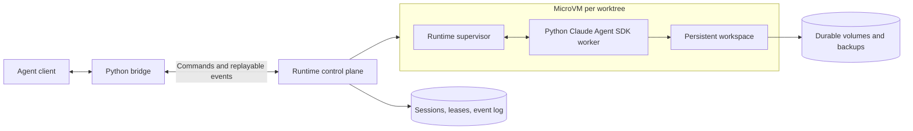

# Design durable agent microVM sandbox

> propose a solution for providing a durable runtime sandbox/microvm for each agent session/domain/worktree that interfaces with the python bridge's i/o claude code agents SDK

<details><summary>2 previous messages</summary>

> I’ll outline an architecture for durable session state, sandbox lifecycle, and the Python bridge to the Claude Agent SDK, including how sessions and worktrees map to runtimes.
>
> I’m using the brainstorming skill for this architecture proposal. I’m assuming “durable” means files and agent conversation state survive disconnects and runtime replacement; preserving live processes would be an additional guarantee. The key design choice is to give each worktree a runtime and each agent session its own SDK process and persisted state.
</details>

I recommend a **durable workspace service backed by microVMs**, with the Python bridge acting as a reconnectable client. Run the Claude Agent SDK inside the microVM so its shell, filesystem access, and subprocesses all execute within the sandbox.

I’m assuming “domain” means an application or security boundary, and that durability means recovering files and agent conversations after a disconnect or host failure.



**1. Separate ownership from execution**

Use this hierarchy:

| Entity | Owns |
|---|---|
| Domain | Identity, credentials policy, network rules, resource limits |
| Workspace/worktree | Repository checkout, dependencies, persistent disk, runtime |
| Agent session | Claude session ID, transcript, permissions, command/event history |
| Runtime incarnation | Current VM, supervisor connection, lease and generation number |

Default to **one microVM per worktree**, with one SDK worker per active agent session. Give sessions separate microVMs when they need independent trust boundaries or concurrent edits to independent copies.

Multiple sessions editing one worktree need an explicit writer lock or coordination policy. Separate SDK processes alone do not prevent filesystem races.

**2. Keep the SDK next to its tools**

Inside each VM, a supervisor launches a Python worker that owns the SDK client and its lifecycle.

The worker:

- Sets the SDK’s working directory to the workspace.
- Accepts prompts and control messages.
- Streams SDK messages into a normalized event protocol.
- Routes permission requests back through the bridge.
- Persists the SDK session identifier and required local session data.

This avoids trying to forward the SDK’s local subprocess I/O across machines. The Python bridge talks to your supervisor protocol; the SDK continues using its supported local execution model.

The exact adapter should be checked against your installed SDK version, especially session persistence, resume, interruption, and permission callbacks.

**3. Make I/O reconnectable**

Use a bidirectional authenticated connection, such as gRPC streaming or WebSockets, with envelopes like:

```text
Command:
  session_id, command_id, runtime_generation, type, payload

Event:
  session_id, sequence, command_id, type, payload
```

Commands cover prompt submission, interruption, permission responses, and closing a session. Events cover SDK output, permission requests, turn completion, and errors.

Persist accepted commands and emitted events outside the VM. On reconnect, the bridge supplies its last acknowledged sequence and receives the missing events.

Key semantics:

- Deduplicate command IDs.
- Serialize turns within a session.
- Separate “command accepted” from “turn completed.”
- Bound output buffering and apply backpressure.
- Keep diagnostics separate from protocol output.

**Event replay restores client visibility; it must not rerun tools.** A crash during an external side effect can leave its outcome uncertain. Mark that turn interrupted and reconcile before retrying.

**4. Define durability in two layers**

| Guarantee | Mechanism |
|---|---|
| Files and uncommitted changes survive VM replacement | Durable workspace volume, with backups |
| Agent conversation resumes | Persisted SDK state plus application session metadata |
| Output survives bridge disconnects | External append-only event log |
| Processes survive idle suspension | Optional VM memory snapshots |
| Processes survive arbitrary host failure | Separate requirement; disk persistence alone is insufficient |

Start with filesystem and conversation recovery. Treat memory snapshots as an optimization: restored network connections and credentials may need renewal, and snapshots do not replace durable storage.

Persist the full repository state, including Git metadata. A linked worktree whose common Git directory lives on a different host will break during recovery; a self-contained clone per workspace is often simpler initially.

**5. Control runtime ownership and recovery**

Use a lifecycle such as:

```text
PROVISIONING → RUNNING → QUIESCING → STOPPED
                  ↓                    ↓
                FAILED → RECOVERING → RUNNING
```

An external lease grants one runtime incarnation write ownership. Recovery must fence the old VM’s disk access and credentials before starting a replacement; a database lease alone cannot stop an isolated old process from writing.

At idle, drain or interrupt active work, flush state, then stop the VM. On resume, attach storage, launch the worker, restore the SDK session, and reconnect event delivery.

**Technology choice**

| Approach | Fit | Trade-off |
|---|---|---|
| Managed microVM service | Recommended starting point | Verify persistent storage, retention, recovery, and snapshot guarantees |
| Self-managed Firecracker | Strong lifecycle and isolation control | Requires scheduling, storage, networking, patching, and recovery operations |
| Containers with persistent volumes | Simpler for trusted internal agents | Shares the host kernel |

Build a small provider interface around `create`, `start`, `stop`, `destroy`, and optional `snapshot/restore`. Keep session state and the event protocol independent of the provider.

The first proof should demonstrate: **disconnect and reconnect during a turn; replace the VM and resume the conversation with uncommitted files intact; interrupt a tool; and reject a stale runtime after recovery.** Those tests establish the durability contract before adding snapshot optimization.

