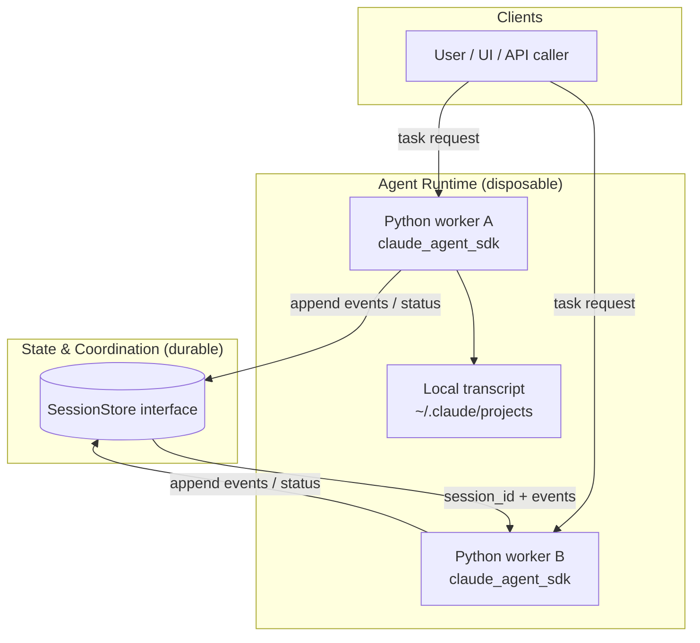
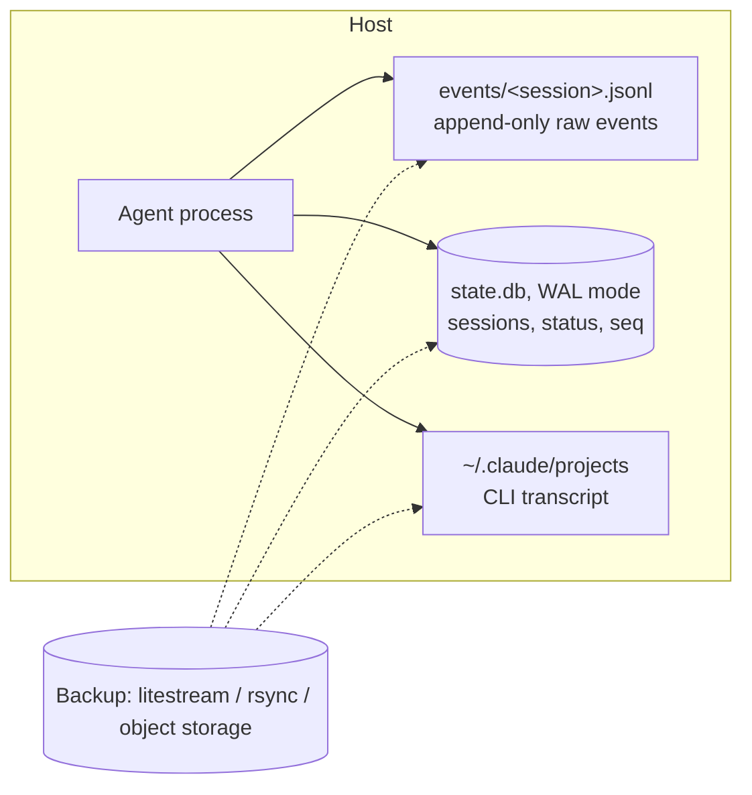
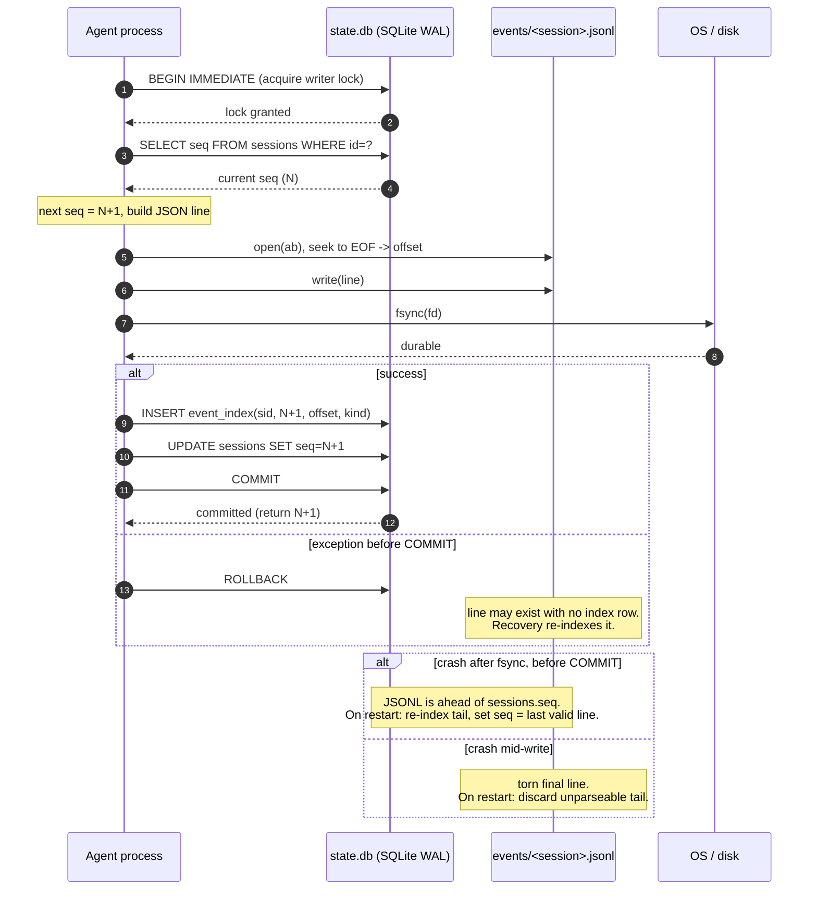
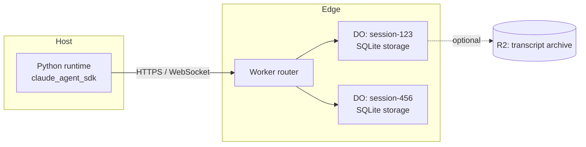

# Session State for Claude Agent SDK (Python): Durable Objects vs. Local JSONL + SQLite

## 1. Key constraint: separate runtime from state

The Python Agent SDK drives Claude Code, which runs as a Node subprocess with filesystem access and a working directory. The runtime is tied to a host. The state you need to keep (session IDs, task status, the event log, transcripts) can live elsewhere. Design around that split:

- **Runtime (disposable):** the process running `ClaudeSDKClient` or `query()`.
- **State (durable):** a store that outlives any runtime.

Resumption uses `ClaudeAgentOptions(resume=session_id)`. The CLI keeps its transcript on local disk, typically under `~/.claude/projects/`. If you move to a new host, that transcript must be restored there before resuming. Verify the path layout and format against your installed SDK and CLI versions, since they can change.

Consequence: Durable Objects can hold state and coordinate sessions, but they can't host the SDK process. Workers lack the subprocess and filesystem the CLI needs. The runtime runs on a VM, container, or similar, and talks to the store over the network.

## 2. Target architecture



Define the interface first. Both backends implement it, so you can switch later without touching agent logic.

```python
from typing import Protocol, Any

class SessionStore(Protocol):
    async def create_session(self, session_id: str, task_id: str) -> None: ...
    async def get_claude_session_id(self, session_id: str) -> str | None: ...
    async def set_claude_session_id(self, session_id: str, claude_sid: str) -> None: ...
    async def append_event(self, session_id: str, kind: str, payload: dict[str, Any]) -> int: ...
    async def load_events(self, session_id: str, after_seq: int = 0) -> list[dict]: ...
    async def set_status(self, session_id: str, status: str) -> None: ...
```

## 3. Option A: Local JSONL + SQLite

### Layout



- **JSONL** is the append-only event log. It's greppable, replayable, and easy to ship as an audit artifact.
- **SQLite** holds the indexed state: session status, the Claude session ID, the current sequence number, and a byte-offset index into the JSONL so you can seek to any event without scanning the file.

### Append path (the critical section)

Each append must write the JSONL line, then commit the index, in an order that survives a crash at any point.

```python
import json, os, sqlite3, time
from pathlib import Path
import asyncio

class LocalStore:
    def __init__(self, root: str = "./data"):
        self.root = Path(root)
        (self.root / "events").mkdir(parents=True, exist_ok=True)
        self.db = self.root / "state.db"
        with self._conn() as c:
            c.execute("PRAGMA journal_mode=WAL")
            c.execute("""CREATE TABLE IF NOT EXISTS sessions(
                id TEXT PRIMARY KEY, task_id TEXT, status TEXT,
                claude_session_id TEXT, seq INTEGER NOT NULL DEFAULT 0,
                created_at REAL, updated_at REAL)""")
            c.execute("""CREATE TABLE IF NOT EXISTS event_index(
                session_id TEXT, seq INTEGER, byte_offset INTEGER, kind TEXT,
                PRIMARY KEY(session_id, seq))""")

    def _conn(self):
        # isolation_level=None: we manage BEGIN/COMMIT explicitly; timeout waits on the writer lock
        return sqlite3.connect(self.db, isolation_level=None, timeout=5.0)

    def _jsonl(self, sid: str) -> Path:
        return self.root / "events" / f"{sid}.jsonl"

    async def append_event(self, session_id: str, kind: str, payload: dict) -> int:
        return await asyncio.to_thread(self._append, session_id, kind, payload)

    def _append(self, sid: str, kind: str, payload: dict) -> int:
        with self._conn() as c:
            c.execute("BEGIN IMMEDIATE")              # one writer at a time
            try:
                row = c.execute("SELECT seq FROM sessions WHERE id=?", (sid,)).fetchone()
                if row is None:
                    raise KeyError(f"unknown session {sid}")
                seq = row[0] + 1
                ts = time.time()
                line = json.dumps({"seq": seq, "kind": kind, "ts": ts, "payload": payload}) + "\n"
                with open(self._jsonl(sid), "ab") as f:
                    offset = f.seek(0, os.SEEK_END)
                    f.write(line.encode("utf-8"))
                    f.flush()
                    os.fsync(f.fileno())              # durable before index says it exists
                c.execute("INSERT INTO event_index VALUES(?,?,?,?)", (sid, seq, offset, kind))
                c.execute("UPDATE sessions SET seq=?, updated_at=? WHERE id=?", (seq, ts, sid))
                c.execute("COMMIT")
                return seq
            except Exception:
                c.execute("ROLLBACK")
                raise
```

### Crash recovery

Crashes can leave the JSONL ahead of SQLite (fsync succeeded, COMMIT didn't) or leave a torn final line. Recovery on startup:

1. For each session, read the JSONL from the end. Discard a final line that doesn't parse (torn write).
2. If the last valid `seq` is greater than `sessions.seq`, re-index the tail into `event_index` and update `sessions.seq`.
3. Treat the JSONL as the source of truth. If `state.db` is lost, rebuild it entirely by scanning the files.

### Sequence diagram of an append

You (completed):
start with this line parts 1/n and 2/n are good this wil be  part 3/n `### Sequence diagram of an append`

Assistant (completed):
### Sequence diagram of an append

The diagram shows the order of operations in `_append`. The JSONL write and `fsync` happen before the SQLite `COMMIT`, so a crash at any step leaves a state that recovery can repair.



### Why this order

| Step | Failure if it crashed here | Recovery |
|---|---|---|
| Write JSONL, no fsync | Line lost on power loss, index may point to nothing | Not allowed: fsync is mandatory before the index write |
| fsync, no COMMIT | JSONL has event N+1, SQLite says N | Scan tail, re-index, advance `seq` |
| Torn line | Partial JSON at EOF | Drop it; the event was never acknowledged |
| COMMIT done | Nothing to repair | None |

The rule is that an event is acknowledged only after `COMMIT`. A caller that gets an exception should retry the append. Deduplicate retries with a client-supplied event ID if the payload can be replayed.

### Limits of this design

- **Single host.** `BEGIN IMMEDIATE` only serializes writers in one SQLite file on one machine. Don't put `state.db` on NFS or share it across hosts.
- **Per-append connection.** Opening a connection per call is simple and safe, but it's the first thing to pool if throughput matters.
- **Transcript is separate.** The CLI's transcript in `~/.claude/projects` is not covered by this log. Back it up too, or your `resume` will fail after a host change.

---

## 4. Option B: Cloudflare Durable Objects

Each session maps to one Durable Object. A DO is single-threaded, so writes to one session are serialized without explicit locks. Its storage is transactional, and it can use the SQLite-backed storage API.



Python Workers can't spawn the CLI subprocess. The SDK process runs on your host, and it reads and writes session state through the Worker over HTTPS or WebSocket. The Durable Object is the source of truth for `seq` and status, and the host keeps only the local CLI transcript.

Trade-offs to check against current Cloudflare docs, since limits and APIs change:
- Per-object throughput is bounded by one thread. That suits per-session writes, not global counters.
- Storage value and row size limits apply, so large tool outputs belong in R2 with a pointer in the DO.
- Egress to the runtime and per-request costs scale with event volume.

---

## 5. Comparison

| Criterion | Local JSONL + SQLite | Durable Objects |
|---|---|---|
| Survives host loss | Only with backups (Litestream, rsync) | Yes, by default |
| Runs fully offline / air-gapped | Yes | No |
| Write coordination | `BEGIN IMMEDIATE`, single host | Single-threaded per object |
| Operational work | You own backups and recovery | Managed by platform |
| Audit / replay | Easy, JSONL is greppable | Requires export or R2 archive |
| Cost at low volume | Near zero | Usage-based, likely near zero |
| Multi-host runtimes | Needs a shared store or pinning | Native, but runtime still needs transcript handling |

## 6. Recommendation

- **Start with the `SessionStore` interface and the local backend.** It's testable without network access, and the crash-recovery rules above apply to any backend.
- **Move to Durable Objects** when you need sessions to survive host loss, or when several runtimes must pick up the same session.
- **Treat the CLI transcript as part of the state.** Whichever backend you choose, snapshot `~/.claude/projects/<project>/` alongside the event log, or `resume` will fail on a new host.

